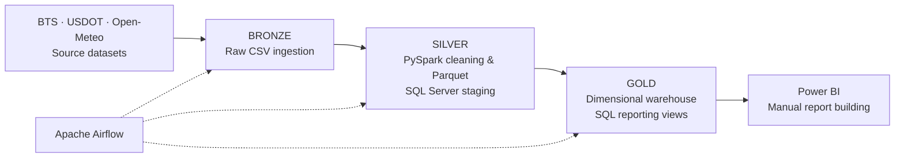

# US Domestic Flight Delays — End-to-End Data Engineering Pipeline

**A collaborative Data Engineering project built to ingest, transform, and analyze US domestic aviation data at scale.**

The project was developed as part of a final assignment for a Data Engineering training program, with the goal of applying the technical skills acquired throughout the training to a practical, end-to-end data pipeline.

It covers **January 2019 to June 2026** in its reference dataset and brings together flight operations, passenger traffic, airport information, and historical weather data. It implements an automated **Bronze → Silver → Gold** pipeline, from source acquisition to a SQL Server dimensional data warehouse and reporting views. Power BI reports are created separately.

**Tech stack:** Python · PySpark / Apache Spark · Apache Airflow · Microsoft SQL Server · Parquet · Power BI · Poetry

## At a glance

| Reference-run metric | Value |
| --- | ---: |
| Raw records processed (Bronze) | **~50 million** |
| Input CSV files | **101** |
| Flight records loaded into the warehouse | **47,494,086** |
| Passenger segments* loaded into the warehouse | **1,970,347** |
| Airports represented in the warehouse | **6,693** |
| Airlines in the analysis scope | **18** |
*Passenger segment: A direct route between an origin and a destination. In this dataset, each record represents monthly passenger traffic for a specific airline and route, rather than an individual flight or passenger.*
> These numbers describe a reference run for the selected 2019–2026 period. The number of files and records varies with the date range processed.

## Project goals

The pipeline was designed to provide a reliable foundation for exploring questions such as:

- How do flight delays evolve across months and years, and what are the main reported causes?
- How do passenger volumes, seasonality, weather, and scheduled departure times relate to delays?
- Which airlines have the highest **proportion of delayed flights**, rather than simply the largest absolute number?

The emphasis is on the **data engineering work behind the analysis**: integrating heterogeneous datasets, applying data-quality rules, designing a warehouse, and orchestrating repeatable loads.

## Architecture



**Bronze — ingestion.** Python scripts download and extract flight and passenger datasets, collect runway reference data, and prepare API-based weather inputs. The original data is retained as CSV files.

**Silver — processing and staging.** PySpark selects relevant fields, applies cleaning and filtering rules, and writes Parquet datasets (partitioned by year and month where appropriate). Processed data is loaded into the `TempSilver` SQL Server database through JDBC to connect PySpark and SQL Server.

**Gold — dimensional modeling.** SQL ETL scripts populate `DWH_DomesticFlights`: two fact tables (`Fact_Flights` and `Fact_Passengers`) supported by airline, airport, date, time, and weather dimensions. SQL views prepare data for Power BI.

**Orchestration.** Airflow coordinates ingestion, Silver processing, staging loads, dimension and fact loading, and the SQL reporting layer. Only the Power BI reporting work remains manual.

## Data sources and processing

| Source | Data | Role in the pipeline |
| --- | --- | --- |
| **Bureau of Transportation Statistics — Flights** | Individual scheduled domestic flights | Flight dates, airlines, delays, cancellations, and reported delay causes |
| **Bureau of Transportation Statistics — Passenger segments** | Monthly traffic records by carrier and route | Passenger volumes, seat capacity, and other traffic measures |
| **U.S. Department of Transportation — Runways** | Airport/runway reference records | Airport attributes and geographical context |
| **Open-Meteo** | Historical weather observations | Weather enrichment for relevant flights; coverage remains partial |

Selected transformation decisions:

- **Flights:** retain cancelled flights; apply quality filters to non-cancelled records with insufficient delay and duration information.
- **Passengers:** exclude zero-passenger segments and restrict the analytical scope to airlines represented in the flight dataset.
- **Runways:** retain one representative runway record per airport, since this airport level of information is sufficient for this analysis.
- **Partitioning:** organize large Parquet datasets by `YEAR` and `MONTH` to keep period-based processing manageable.

## Data warehouse and reporting

The model deliberately handles **two different time granularities**:

- `Fact_Flights` contains **one row per flight** and uses a daily flight-date dimension.
- `Fact_Passengers` contains **monthly passenger-segment records** and uses a monthly date dimension.

Reporting can align both facts on their common **year and month**, with flight measures aggregated before combining them with monthly passenger totals. This avoids artificially multiplying passenger counts when joining datasets with different grains.

One implemented SQL reporting view ranks airlines by **arrival-delay rate**:

**Delay rate = flights arriving at least 15 minutes late ÷ operated flights × 100**

Cancelled flights are excluded from this ranking. Using a ratio makes airline comparisons more meaningful than ranking by raw delay counts alone.

## Engineering challenges and solutions

### 1. Repeatable loads and duplicate prevention

To support safe DAG reruns, PySpark generates a `ROW_HASH` from the business values of each record. Unique SQL Server indexes (including `IGNORE_DUP_KEY` where configured) help prevent duplicate staging records. Warehouse ETL scripts also check existing business keys before inserting new dimension and fact rows.

### 2. Inconsistent airport identifiers

The flight/passenger sources and runway reference data sometimes use different identifiers for the same airport (for example, `AZA → IWA` and `FCA → GPI`). Missing matches initially excluded passenger records during warehouse loading.

After introducing explicit airport-code mappings, the retained passenger coverage within the selected airline scope improved from **99.285% to 99.9992%** — reducing excluded passengers from **37,908,220 to 43,145**.

### 3. Memory optimisation

Although PySpark is designed for distributed data processing, this project was developed and executed on a single local machine for educational purposes.

Processing nearly 50 million records while running PySpark, SQL Server, and Airflow on the same machine required careful memory and resource management.

To overcome these limitations, we optimised Spark partitioning, reduced JDBC batch sizes, and controlled the number of concurrent writes to SQL Server. These adjustments helped reduce memory pressure, prevent SQL Server resource exhaustion, and improve the stability of the pipeline when handling large datasets.

## Repository organization

```text
Data/
├── Bronze/
└── Silver/

Scripts/
├── Python/
│   ├── API/
│   ├── Airflow/
│   ├── Constants/
│   └── Scraping/
└── SQL/
    ├── CREATE TABLES/
    ├── ETL/
    └── VUES/

Drivers/
```

The repository separates **source acquisition, Spark-based processing, orchestration, SQL modeling, and analytical views**, so each stage of the pipeline has a clear responsibility.

## Current scope and next steps

The **data pipeline through the SQL reporting layer is automated**. The key remaining limitations and planned improvements are:

- **Weather enrichment:** the API integration and warehouse structures are in place, but historical weather coverage is incomplete because of API request limits.
- **Analytics:** expand the set of business-focused SQL views and Power BI visualizations.
- **Performance:** continue reducing processing time and memory consumption during large JDBC loads.

## Project presentation

A PowerPoint walkthrough of the architecture, dimensional models, ETL decisions, monitoring results, and reporting is intended to accompany this repository:

**[View the project presentation](Domestic Flight Project Presentation.pdf)**

<!-- Add the PowerPoint at docs/project_presentation.pptx, or update the link above to match its location in the repository. -->
